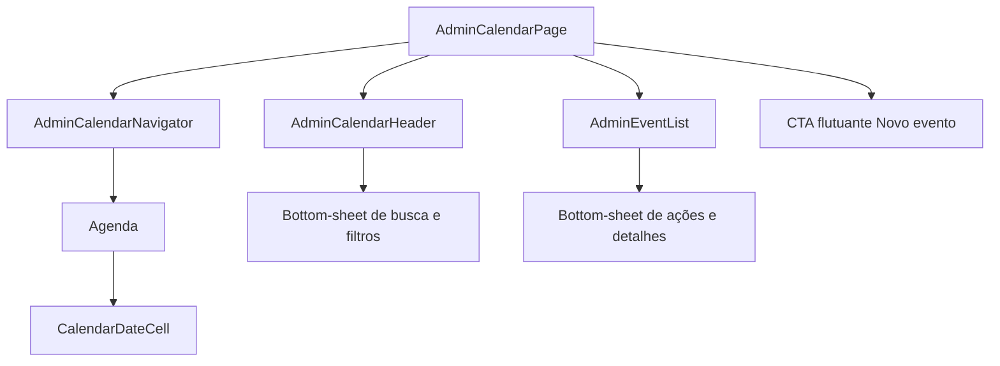

# Design Document: Admin Calendar Mobile Simplification

## Overview

A agenda administrativa será simplificada com abordagem mobile-first para reduzir carga visual sem prejudicar consulta de eventos, navegação entre datas e cadastro. Clareza e previsibilidade têm prioridade para usuários com pouca familiaridade digital.

O desktop preservará a estrutura e as ações atuais, recebendo somente ajustes responsivos compartilhados necessários. A implementação não alterará API, modelos de evento, regras de recorrência ou dependências.

## Architecture

`AdminCalendarPage` mantém o estado da visualização. `Agenda` usa divulgação progressiva: semana por padrão e mês expandido sob demanda no mesmo espaço. Classes responsivas preservam a experiência desktop.

## Components and Interfaces

### `AdminCalendarPage.tsx`
- Compõe a tela e mantém a data selecionada refletida na URL.
- Renderiza o CTA flutuante mobile `Novo evento` apenas sem formulário, filtros ou confirmação de exclusão abertos.
- Reserva espaço inferior para impedir sobreposição do CTA sobre a lista.

### `AdminCalendarHeader.tsx`
- No mobile, exibe título `Agenda` e um botão de busca/filtros com alvo mínimo de 44 px.
- Mantém o indicador de filtros ativos e preserva o cabeçalho desktop completo.

### `AdminCalendarNavigator.tsx`
- Mantém mês/ano, anterior, próximo e `Hoje` quando aplicável.
- Remove no mobile o seletor duplicado `Semana | Mês` e delega expansão/recolhimento à `Agenda`.
- Continua usando `AgendaView = 'week' | 'month'` para definir navegação por semana ou mês.

### `Agenda.tsx`
- Inicia na visão semanal e oferece `Ver mês completo`; na visão mensal oferece `Recolher`.
- Preserva swipe horizontal para mudar semana ou mês.
- Exibe sete datas na semana e um grid mensal visualmente leve, sem quantidades ou linhas fortes.

### `CalendarDateCell.tsx`
- Exibe número do dia e um único indicador discreto quando houver eventos.
- Mantém alto contraste para data selecionada, destaque secundário para hoje e aparência atenuada para dias adjacentes.

### `AdminEventList.tsx`
- No mobile, exibe somente horário, título e local; tocar na linha ou no menu abre o mesmo painel de ações.
- No desktop, preserva metadados e ações atuais.
- Mantém estados vazio, carregando e erro com textos curtos.

## Data Models

Nenhum modelo será criado ou alterado. `CalendarEvent` e todos os tipos de API, recorrência, filtros e formulários existentes permanecem como estão; os componentes afetados somente mudam apresentação responsiva e composição.

## Data and Behavioral Contracts

- A URL continua refletindo a data selecionada.
- Mudanças de data atualizam a lista sem navegação de página.
- APIs, modelos `CalendarEvent` e regras de recorrência permanecem inalterados.
- Busca e filtros permanecem em bottom-sheet acionado por um único botão mobile.
- Formulários, diálogos e ações administrativas existentes preservam o comportamento.

## Error Handling

- Estados de carregamento, vazio e erro permanecem visíveis com mensagens curtas.
- Falhas existentes de consulta ou mutação continuam usando o tratamento atual; esta mudança não introduz novo contrato de erro.

## Testing Strategy

- Atualizar exclusivamente `src/features/calendar/AdminCalendarPage.test.tsx`; não criar arquivos de teste.
- Cobrir por exemplos o fluxo progressivo, CTA flutuante, abertura da linha mobile, menu e ações existentes.
- Executar o teste focal, `npm run build` e ESLint somente nos arquivos afetados.
- Fazer inspeção responsiva manual em 360 px, 390 px e 768 px, incluindo regressão desktop.
- Não se aplicam propriedades PBT: o escopo é renderização responsiva e interação de UI, mais adequadas a testes de exemplo e inspeção responsiva.

## Performance Considerations

- Reutilizar componentes, estado e dados existentes, sem novas consultas ou dependências.
- A expansão mensal ocorre no mesmo componente, sem navegação ou camada adicional.

## Security Considerations

- Preservar controles, callbacks e autorização existentes; nenhuma superfície de API ou modelo será alterada.

## Dependencies

- React 19, TypeScript 5.8, React Router, TanStack Query, Tailwind CSS 4, Vitest e Testing Library já presentes.
- Nenhuma dependência nova será adicionada.