# Implementation Plan: Admin Calendar Mobile Simplification

## Overview

Implementar a simplificação mobile-first em TypeScript/React por incrementos acíclicos: calendário progressivo, cabeçalho/CTA, lista mobile e integração final. Cada tarefa depende somente de tarefas anteriores e termina com os componentes conectados à página existente.

## Restrições globais

- Preservar integralmente a estrutura e as ações desktop.
- Preservar APIs, modelos de evento e regras de recorrência.
- Não adicionar dependências nem alterar manifestos ou lockfiles.
- Atualizar somente `src/features/calendar/AdminCalendarPage.test.tsx`; não criar testes novos.
- Não criar commits sem solicitação explícita.
- Usar apenas os arquivos indicados em cada tarefa.

## Task Dependency Graph

```mermaid
graph LR
  A[1.1 Teste calendário] --> B[1.2 Navigator]
  B --> C[1.3 DateCell]
  C --> D[1.4 Agenda]
  D --> E[1.5 Validação calendário]
  E --> F[2.1 Teste CTA]
  F --> G[2.2 Header]
  G --> H[2.3 CTA Page]
  H --> I[2.4 Validação CTA]
  I --> J[3.1 Teste linha]
  J --> K[3.2 EventList]
  K --> L[3.3 Skeleton]
  L --> M[3.4 Validação lista]
  M --> N[4.1 Integração]
  N --> O[4.2 Testes]
  O --> P[4.3 Build]
  O --> Q[4.4 Lint]
  P --> R[4.5 Revisão final]
  Q --> R
```

## Tasks

- [ ] 1. Implementar calendário progressivo e visualmente leve
  - [ ]* 1.1 Atualizar o fluxo progressivo no teste existente
    - Em `AdminCalendarPage.test.tsx`, substituir o caso de alternância por abas por um caso que verifica semana inicial, `aria-expanded=false`, expansão por `Ver mês completo`, `Recolher`, grid mensal e abertura de filtros.
    - Executar `npm test -- src/features/calendar/AdminCalendarPage.test.tsx` e confirmar a falha anterior à implementação.
    - Dependências: nenhuma.
    - _Requirements: 2.1, 2.2, 2.3, 2.6, 4.2, 7.5, 8.1_

  - [ ] 1.2 Delegar expansão e recolhimento à `Agenda`
    - Em `AdminCalendarNavigator.tsx`, remover o seletor mobile `Semana | Mês` e o import não utilizado de `classNames`.
    - Passar `onViewChange` à `Agenda`, manter `view` para navegação por período e preservar mês/ano, setas e `Hoje`.
    - Dependências: 1.1.
    - _Requirements: 2.2, 2.3, 2.6, 3.1, 3.2, 3.6, 7.1, 7.2, 7.3_

  - [ ] 1.3 Simplificar a célula de data
    - Em `CalendarDateCell.tsx`, substituir badge e contagem por um único ponto sem quantidade quando `eventCount > 0` e a data não for adjacente.
    - Usar célula mensal com altura mínima de 48 px, número centralizado e ponto abaixo; preservar estilos distintos de selecionado, hoje e adjacente.
    - Dependências: 1.2.
    - _Requirements: 1.3, 2.4, 2.5, 7.2_

  - [ ] 1.4 Aliviar os grids semanal e mensal
    - Em `Agenda.tsx`, usar espaçamento leve e fundo branco, remover linhas e fundos fortes e manter sete datas na semana.
    - Implementar o controle acessível `Ver mês completo`/`Recolher` no mesmo espaço, com `aria-expanded` coerente e sem alterar swipe ou seleção.
    - Dependências: 1.3.
    - _Requirements: 1.3, 1.4, 2.1, 2.2, 2.3, 2.4, 2.5, 3.3, 3.4, 3.5_

  - [ ]* 1.5 Validar o calendário progressivo
    - Executar `npm test -- src/features/calendar/AdminCalendarPage.test.tsx` em modo único.
    - Confirmar expansão/recolhimento, filtros e regressões existentes sem criar outro arquivo de teste.
    - Dependências: 1.4.
    - _Requirements: 2.1, 2.2, 2.3, 2.6, 4.2, 7.5, 8.1_

- [ ] 2. Implementar cabeçalho compacto e CTA flutuante
  - [ ]* 2.1 Acrescentar cobertura do CTA ao teste existente
    - Em `AdminCalendarPage.test.tsx`, localizar `mobile-create-event`, verificar o nome acessível `Novo evento`, acioná-lo e confirmar o formulário existente.
    - Executar `npm test -- src/features/calendar/AdminCalendarPage.test.tsx -t "abre o formulário"` e confirmar a falha anterior à implementação.
    - Dependências: 1.5.
    - _Requirements: 4.4, 4.5, 4.7, 6.4, 7.5, 8.1_

  - [ ] 2.2 Compactar o cabeçalho mobile
    - Em `AdminCalendarHeader.tsx`, remover `Plus` e o botão mobile de criação.
    - Manter no mobile o título `Agenda`, o botão de filtro de 44 px, nome acessível e indicador amber de filtro ativo; preservar o cabeçalho desktop completo.
    - Dependências: 2.1.
    - _Requirements: 1.2, 1.3, 1.4, 4.1, 4.2, 4.3_

  - [ ] 2.3 Renderizar o CTA flutuante na página
    - Em `AdminCalendarPage.tsx`, importar `Plus` da dependência existente e renderizar `mobile-create-event` somente no mobile quando `editor`, `deleteCandidate` e `filtersOpen` estiverem fechados.
    - Posicionar o CTA acima de `env(safe-area-inset-bottom)`, conectar `openCreate` e adicionar padding inferior mobile para proteger o último item.
    - Dependências: 2.2.
    - _Requirements: 1.1, 4.4, 4.5, 4.6, 4.7, 6.4, 7.4_

  - [ ]* 2.4 Validar cabeçalho e CTA
    - Executar `npm test -- src/features/calendar/AdminCalendarPage.test.tsx` em modo único.
    - Confirmar abertura do formulário, ocultação do CTA durante overlays, filtros e fluxos administrativos já cobertos.
    - Dependências: 2.3.
    - _Requirements: 4.1, 4.2, 4.4, 4.5, 4.7, 6.4, 8.1_

- [ ] 3. Implementar a lista mobile simplificada
  - [ ]* 3.1 Cobrir a área tocável no teste existente
    - Em `AdminCalendarPage.test.tsx`, no caso de ações, acionar `Abrir ações de Santa Missa`, verificar um diálogo, fechá-lo com Escape e manter a cobertura do menu explícito.
    - Executar `npm test -- src/features/calendar/AdminCalendarPage.test.tsx -t "abre apenas um painel"` e confirmar a falha anterior à implementação.
    - Dependências: 2.4.
    - _Requirements: 5.3, 5.4, 5.5, 6.1, 6.2, 6.3, 7.5, 8.1_

  - [ ] 3.2 Reduzir a linha mobile de evento
    - Em `AdminEventList.tsx`, mostrar no mobile somente horário, título e local; ocultar duração e recorrência até `md` e tipo até `sm`.
    - Remover timeline decorativa mobile, compactar espaçamento e usar grade com colunas de horário, conteúdo e menu.
    - Adicionar área tocável mobile com nome `Abrir ações de {título}` sem cobrir o botão `Ações de {título}`; ambas devem abrir uma única instância do painel existente.
    - Preservar todos os metadados, callbacks e ações desktop.
    - Dependências: 3.1.
    - _Requirements: 1.2, 1.3, 1.4, 5.1, 5.2, 5.3, 5.4, 5.5, 6.1, 6.2, 6.3, 7.1, 7.2, 7.3_

  - [ ] 3.3 Alinhar o skeleton ao formato mobile
    - Em `AdminEventList.tsx`, reduzir o skeleton mobile para duas linhas compactas e manter a coluna de ações no desktop.
    - Preservar os estados vazio e erro existentes e a transição de loading para erro.
    - Dependências: 3.2.
    - _Requirements: 5.6, 5.7, 5.8_

  - [ ]* 3.4 Validar lista e ações administrativas
    - Executar `npm test -- src/features/calendar/AdminCalendarPage.test.tsx` em modo único.
    - Confirmar abertura por linha, menu único, edição, duplicação, exclusão, criação e recorrência existente.
    - Dependências: 3.3.
    - _Requirements: 5.3, 5.4, 5.5, 6.1, 6.2, 6.3, 6.4, 7.3, 8.1_

- [ ] 4. Integrar e validar a entrega
  - [ ] 4.1 Revisar a integração responsiva
    - Revisar `AdminCalendarPage.tsx`, `Agenda.tsx`, `CalendarDateCell.tsx`, `AdminCalendarHeader.tsx`, `AdminCalendarNavigator.tsx` e `AdminEventList.tsx` como um fluxo único.
    - Confirmar por código que a URL e atualização da lista permanecem conectadas, que classes `md` preservam desktop e que nenhum contrato, modelo, recorrência, dependência ou arquivo de teste adicional foi alterado.
    - Dependências: 3.4.
    - _Requirements: 1.1, 1.2, 3.4, 3.5, 4.6, 5.2, 7.1, 7.2, 7.3, 7.4, 7.5_

  - [ ]* 4.2 Executar a suíte focal completa
    - Executar `npm test -- src/features/calendar/AdminCalendarPage.test.tsx` e registrar o resultado.
    - Dependências: 4.1.
    - _Requirements: 8.1_

  - [ ]* 4.3 Executar build e typecheck
    - Executar `npm run build`; exigir exit code 0 para `tsc -b` e `vite build`.
    - Dependências: 4.2.
    - _Requirements: 7.1, 7.2, 7.3, 8.2_

  - [ ]* 4.4 Executar lint focal independentemente do build
    - Executar `npx eslint src/features/calendar/AdminCalendarPage.tsx src/features/calendar/AdminCalendarPage.test.tsx src/features/calendar/components/Agenda.tsx src/features/calendar/components/CalendarDateCell.tsx src/features/calendar/admin/components/AdminCalendarHeader.tsx src/features/calendar/admin/components/AdminCalendarNavigator.tsx src/features/calendar/admin/components/AdminEventList.tsx`.
    - Executar mesmo se 4.3 falhar e registrar o resultado separadamente.
    - Dependências: 4.2.
    - _Requirements: 8.3_

  - [ ] 4.5 Fazer revisão final sem commit
    - Consolidar resultados de teste, build e lint; listar arquivos alterados e quaisquer falhas remanescentes.
    - Confirmar ausência de arquivos de teste novos, mudanças em dependências e commits.
    - Não executar servidor, watcher, commit ou alteração adicional durante esta tarefa.
    - Dependências: 4.3 e 4.4.
    - _Requirements: 7.4, 7.5, 8.6_

## Notes

- Tarefas marcadas com `*` são validações/testes opcionais no executor Kiro, mas permanecem parte do plano recomendado.
- Não há tarefas de property-based testing porque o design não define propriedades universais aplicáveis.
- A inspeção responsiva manual prevista no design deve ser conduzida pelo usuário fora deste DAG de código em 360 px, 390 px e 768 px; o agente não inicia servidor ou watcher.
- Para iniciar a implementação posteriormente, abra este arquivo e clique em **Start task** na tarefa desejada.